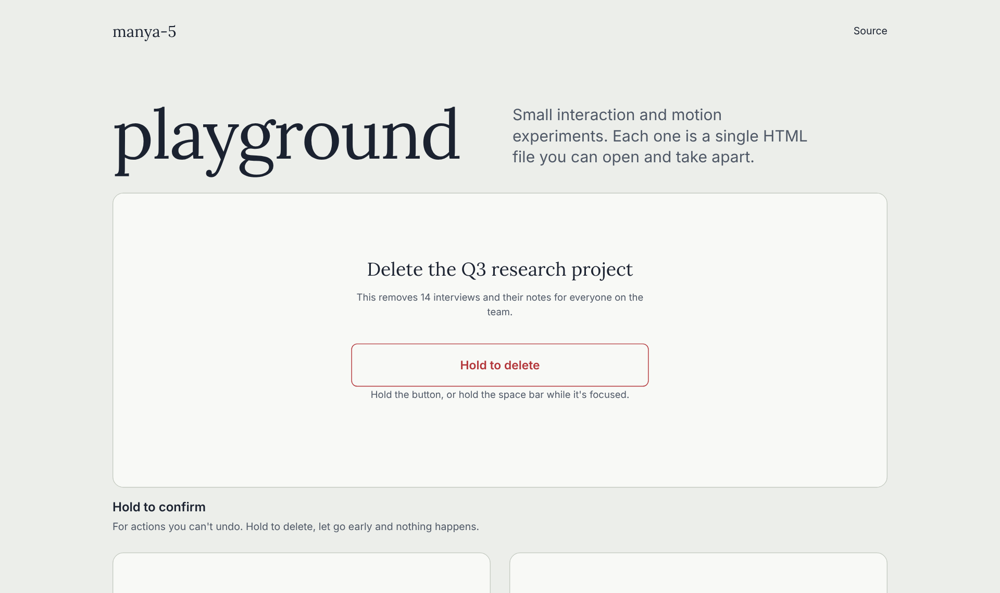

# playground

Small interaction and motion experiments, each with its own live demo.



**Live:** https://manya-5.github.io/playground/

## Why I built this

Most of what makes an interface feel trustworthy happens in the half second after you click. I wanted a place to try those moments in real code instead of describing them in a spec. Each one is small enough to read in a few minutes.

## How it works

Every experiment is one HTML file with its own CSS and JavaScript, and no build step or framework.

| Experiment | What to try |
|---|---|
| [Button press](https://manya-5.github.io/playground/press/) | Fast down, springy up. Drag off the button to cancel. |
| [Loading state](https://manya-5.github.io/playground/loading/) | Named steps, progress that only moves when a step finishes, and a Stop button. |
| [Drag to archive](https://manya-5.github.io/playground/drag/) | Drag past 40% or flick to archive. Short, slow drags spring back. |
| [Toast with undo](https://manya-5.github.io/playground/toast/) | Delete files, then undo. Hover a toast to pause its timer. |
| [Hold to confirm](https://manya-5.github.io/playground/hold/) | Hold for 1.5 seconds to delete. Let go early and nothing happens. |

They all share `docs/tokens.css` (from my [tokens](https://github.com/manya-5/tokens) repo), work with a keyboard, and respect reduced motion.

## Run it locally

No install needed. Any static file server works.

```bash
git clone https://github.com/manya-5/playground.git
cd playground
python3 -m http.server 8000 --directory docs
```

Then open http://localhost:8000.
